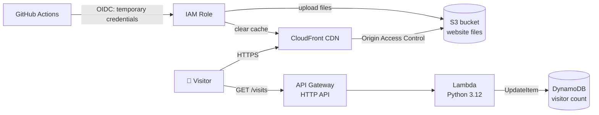

# ☁️ AWS Cloud Resume: Serverless Portfolio with Terraform & CI/CD


My personal CV website, hosted on **AWS** with a **serverless visitor counter**. Every AWS resource is created with **Terraform**, and **GitHub Actions** tests and deploys it automatically.

I built this project to learn cloud engineering hands-on: storage, CDN, serverless compute, databases, IAM security, Infrastructure as Code and CI/CD.

**🌐 Live site:** https://d2du93xpbftyo5.cloudfront.net

---

## 🏗️ Architecture



| AWS service | What it does in this project |
|---|---|
| **S3** | Stores the website files (HTML, CSS, JS). The bucket is fully **private**. |
| **CloudFront** | A global CDN that serves the site fast over **HTTPS**. It is the only thing allowed to read the bucket. |
| **API Gateway** | Gives the visitor counter a public URL, with CORS and rate limiting. |
| **Lambda** | Python function that adds 1 to the visitor count and returns the total. |
| **DynamoDB** | NoSQL database storing the count. Pay-per-request, so it costs nothing when idle. |
| **IAM** | Roles with **least-privilege** permissions for Lambda and for GitHub. |
| **CloudWatch** | Stores Lambda logs for 14 days. |

## ✨ Key features

- **Infrastructure as Code:** the whole stack is defined in Terraform (`infra/`). One command builds it and one command deletes it.
- **Serverless:** no servers to manage or patch, and it scales automatically.
- **Secure by default:**
  - Private S3 bucket that only CloudFront can read (Origin Access Control)
  - HTTPS enforced
  - Least-privilege IAM: the Lambda can only `UpdateItem` on one table
  - **OIDC** for GitHub → AWS: no long-lived access keys stored anywhere
  - CORS restricts the API to this website only
  - API throttling protects against abuse and surprise bills
- **CI/CD with GitHub Actions:**
  - `ci.yml` runs Python unit tests plus `terraform fmt` and `terraform validate` on every push
  - `deploy.yml` uploads the site to S3 and clears the CloudFront cache when `frontend/` changes
- **Tested:** unit tests use a fake DynamoDB table, so they run in milliseconds without AWS.

## 📁 Project structure

```
aws-cloud-resume/
├── frontend/                 # The website
│   ├── index.html
│   ├── style.css
│   ├── script.js             # Calls the visitor counter API
│   └── config.js             # Placeholder; Terraform writes the real one in S3
├── backend/
│   ├── lambda/visitor_counter.py
│   ├── tests/test_visitor_counter.py
│   └── requirements-dev.txt
├── infra/                    # Terraform (Infrastructure as Code)
│   ├── providers.tf          # AWS provider and region
│   ├── variables.tf          # Settings
│   ├── frontend.tf           # S3 + CloudFront
│   ├── backend.tf            # DynamoDB + Lambda + API Gateway + IAM
│   ├── github_oidc.tf        # Keyless GitHub → AWS login
│   └── outputs.tf            # URLs and IDs printed after deploy
└── .github/workflows/
    ├── ci.yml                # Test & validate
    └── deploy.yml            # Deploy website
```

## 🚀 How to deploy it

The easiest way is **AWS CloudShell**, a terminal inside the AWS Console that is already logged in to your account. You don't need to install anything on your computer.

**1. Open CloudShell.** Log in to the AWS Console, choose the **Stockholm (eu-north-1)** region (my AWS Free plan project is limited to one region), and click the `>_` icon at the top.

**2. Install Terraform**
```bash
curl -fsSLO https://releases.hashicorp.com/terraform/1.9.8/terraform_1.9.8_linux_amd64.zip
unzip -o terraform_1.9.8_linux_amd64.zip -d ~/bin
echo 'export PATH=$HOME/bin:$PATH' >> ~/.bashrc && source ~/.bashrc
terraform -version
```

**3. Download this project**
```bash
git clone https://github.com/chandakbari/aws-cloud-resume.git
cd aws-cloud-resume/infra
```

**4. Build the infrastructure**
```bash
terraform init      # download the AWS provider
terraform plan      # preview what will be created
terraform apply     # type "yes" to create it
```
At the end, Terraform prints `website_url`, `s3_bucket`, `cloudfront_distribution_id` and `github_role_arn`.

**5. Connect GitHub Actions.** In the GitHub repo, go to **Settings → Secrets and variables → Actions → Variables** and add:

| Variable | Value |
|---|---|
| `AWS_ROLE_ARN` | the `github_role_arn` output |
| `S3_BUCKET` | the `s3_bucket` output |
| `CLOUDFRONT_DISTRIBUTION_ID` | the `cloudfront_distribution_id` output |
| `AWS_REGION` | `eu-north-1` |

These are not secrets. The OIDC trust policy means only this repo's `main` branch can use the role.

**6. Deploy the website.** Go to **Actions → Deploy website → Run workflow**. From then on, every change to `frontend/` deploys itself.

**7. Open the `website_url`.** CloudFront can take a few minutes the first time.

> If `terraform apply` says the GitHub OIDC provider already exists, run
> `terraform apply -var="create_github_oidc_provider=false"`.

## 💷 Cost

All services used have free-tier allowances or pay-per-use pricing, so a personal site like this should cost little or nothing. The account has an **AWS Budget** of $20/month with email alerts at 50%, 80% and 100% (forecasted), so any unexpected spending is caught early.

## 🧹 Delete everything

```bash
cd aws-cloud-resume/infra
terraform destroy   # type "yes"
```

## 📚 What I learned

- How a static site is served securely through a CDN from a private bucket
- How serverless functions, APIs and NoSQL databases work together
- Writing Infrastructure as Code with Terraform: resources, variables, outputs and dependencies
- IAM roles, policies and the principle of least privilege
- Building CI/CD pipelines with GitHub Actions and keyless OIDC authentication
- Writing unit tests with a fake (mocked) dependency

## 🔮 Next improvements

- Custom domain with Route 53 and an ACM certificate
- Store Terraform state remotely in S3 with locking
- Run `terraform plan` automatically on pull requests
- Add CloudWatch alarms for Lambda errors

---

Built by **Chand Akbari** · [LinkedIn](https://www.linkedin.com/in/chand-akbari) · Inspired by the Cloud Resume Challenge
